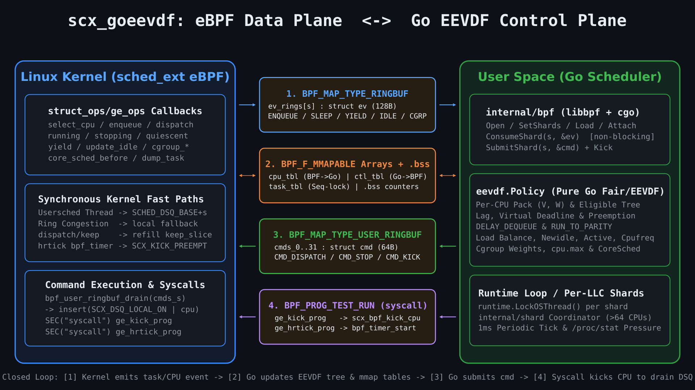

# scx_goeevdf

[English](./README.md) | [繁體中文](./README.zh.md)

`scx_goeevdf` is an experimental Linux [`sched_ext`](https://www.kernel.org/doc/html/latest/scheduler/sched-ext.html) user-space CPU scheduler written in Go, implementing **EEVDF (Earliest Eligible Virtual Deadline First)** mechanisms inspired by Linux's `fair.c` (modeled on [`scx_reevdf`](https://github.com/sched-ext/scx/pull/3926) and built on the eBPF/cgo transport patterns from [`Gthulhu/qumun`](https://github.com/Gthulhu/qumun)).

Scheduling policy, virtual runtime accounting, augmented eligible-deadline trees, placement, load balancing, cgroup weights and quotas, capacity pressure, and cpufreq targeting live in Go (`eevdf/`). The kernel eBPF program (`bpf/goeevdf.bpf.c`) streams lifecycle events, executes dispatch commands, and handles synchronous kernel callbacks.

**This is not yet a complete port or a production-ready scheduler.** See
[ALIGNMENT.md](./ALIGNMENT.md) for implemented slices, remaining gaps, and measured
acceptance. In particular, full placement parity, cross-shard group load,
`cpu.max.burst`, dynamic sharded quota updates, monitoring, and the complete
simulation/VM acceptance matrix remain unfinished.

---

## Architecture: How eBPF Interacts with the Go Application


<details>
<summary>View Static High-Resolution Diagram (PNG)</summary>



</details>

> The visualization above is rendered with [Manim](./docs/manim/ebpf_go_interaction.py).

### Four Communication Channels Across the Kernel / User-Space Boundary

`scx_goeevdf` decouples kernel mechanisms from user-space scheduling decisions through four zero-copy or non-blocking channels:

| # | Channel | Direction | eBPF Side (`bpf/goeevdf.bpf.c`) | Go Side (`internal/bpf` & `cmd/goeevdf`) | Purpose |
|---|---|---|---|---|---|
| **1** | **Event Ring Buffer** (`BPF_MAP_TYPE_RINGBUF` inside `ev_rings` `ARRAY_OF_MAPS`) | **eBPF → Go** | `ev_reserve()` + `bpf_ringbuf_submit()` writes 128-byte `struct ev` records (`EV_ENQUEUE`, `EV_SLEEP`, `EV_DEQUEUE`, `EV_YIELD`, `EV_IDLE`, `EV_CPUMASK`, `EV_CGRP_*`) | `Sched.ConsumeShard(s, &ev)` drains events one by one without blocking (`ring_buffer__consume`) | Streams task wakeups, slice expirations, sleep/exit transitions, idle CPU notifications, and cgroup updates to the owning Go shard |
| **2** | **Shared Memory Tables** (`BPF_F_MMAPABLE` arrays + `.bss` + `.rodata`) | **Bidirectional (Zero-Copy)** | Reads/writes `cpu_tbl`, `ctl_tbl`, `task_tbl`, and `.bss` counters (`nr_queued_s`, `nr_scheduled_s`, `nr_ev_drops`) | Direct `syscall.Mmap` slices (`s.CPU`, `s.Ctl`, `s.Task`, `s.bss`) accessed via `sync/atomic` | Zero-syscall state sharing: BPF reports running PID, `run_seq`, idle state, and RT/DL displacement (`cpu_tbl`); Go publishes `nr_queued`, `keep_slice`, `perf_target` (`ctl_tbl`), and sequence-locked task vruntime/deadline (`task_tbl`) |
| **3** | **Command User Ring Buffer** (`BPF_MAP_TYPE_USER_RINGBUF`, `cmds_0..31`) | **Go → eBPF** | `ge_dispatch` drains commands and inserts tasks into `SCX_DSQ_LOCAL_ON \| cpu`, or stops running tasks | `Sched.SubmitShard(s, &cmd)` submits 64-byte DISPATCH, STOP and KICK records | Sends EEVDF decisions back to the kernel |
| **4** | **Syscall Programs** (`SEC("syscall")` via `BPF_PROG_TEST_RUN`) | **Go → eBPF** | `ge_kick_prog` invokes `scx_bpf_kick_cpu`; `ge_hrtick_prog` arms a run-sequence-guarded timer | `Sched.Kick(cpu, flags)`; `SubmitShard` routes `CmdHrtick` directly to the hrtick syscall, not the command ring | Wakes/preempts CPUs and arms timers; no standalone Go `Hrtick` method |

### Closed-Loop Execution Lifecycle

1. **Scheduler Exemption & Self-Scheduling**: Before `Load()`, Go writes its process TGID (`usersched_tgid`) and CPU-to-shard ownership (`cpu_shard[]`, `nr_shards`) into `.rodata`. Each Go scheduler OS thread (`runtime.LockOSThread()`) registers its Linux TID in `usersched_tids`. When a scheduler thread is enqueued, eBPF bypasses user-space rings and dispatches it directly to `SCHED_DSQ_BASE + shard` so the scheduler never deadlocks waiting for itself.
2. **Task Enqueue**: For normal tasks, `ge_enqueue` marks the task waiting, increments the shard backlog and emits `EV_ENQUEUE`. There is no general idle-CPU bypass of Go policy. If the event ring is full, kernel-local dispatch preserves progress.
3. **Go EEVDF Policy Evaluation**: The Go loop consumes up to 512 events per batch, updates the per-CPU EEVDF `Pack` and augmented eligible-deadline tree (`eevdf/tree.go`), computes virtual deadlines and wakeup preemption, and updates `ctl_tbl[cpu]` (`nr_queued`, `keep_slice`) and `task_tbl[slot]` (`core_vtime`, `vruntime`, `deadline`, `lag`).
4. **Command Dispatch & Kernel Drain**: Go emits `CMD_DISPATCH` and kicks the target CPU. `ge_dispatch` validates task state, enqueue sequence and affinity, then inserts directly into `SCX_DSQ_LOCAL_ON | cpu`. Separate `SCHED_DSQ_BASE + shard` queues serve scheduler threads only.
5. **Synchronous Kernel Collaborators**:
   - **Slice Continuation (`keep_running`)**: `ge_dispatch` can refill the previous task's slice using Go's `keep_slice` authorization and emit `EV_KEEP`. This is not a `ge_tick`/`ge_stopping` refill path.
   - **High-Resolution Preemption (`hrtick`)**: If `CMDF_HRTICK` is set on a dispatch command or triggered via `ge_hrtick_prog`, eBPF arms a per-CPU `bpf_timer` (`BPF_F_TIMER_ABS`) that fires `scx_bpf_kick_cpu(cpu, SCX_KICK_PREEMPT)` at the exact preemption deadline.
   - **Core Scheduling & Task Dump**: `ge_core_sched_before` and `ge_dump_task` read Go's sequence-locked `task_tbl[slot]` directly in kernel context.

---

## Key Features

- **EEVDF Accounting (`eevdf/accounting.go`, `eevdf/pack.go`, `eevdf/tree.go`)**:
  - Per-CPU `Pack` maintaining weighted reference virtual time $V$ with remainder preservation.
  - Augmented treap with expected $O(\log N)$ eligible-deadline lookup (`min_vruntime` subtree pruning) and reusable nodes; it is not a red-black tree.
  - Lag clamping, `PLACE_LAG`, `PLACE_REL_DEADLINE`, `RUN_TO_PARITY` slice protection, `PREEMPT_SHORT`, and `DELAY_DEQUEUE` / `DELAY_REQUEUE` debt repayment.
- **Topology-Aware Placement & Three-Stage Load Balancing (`eevdf/placement.go`, `eevdf/balance.go`, `eevdf/newidle.go`, `eevdf/active.go`)**:
  - Wakeup CPU selection across SMT core, LLC, NUMA node, and system hierarchy (`WAKE_SYNC`, `WA_WEIGHT`, `SIS_UTIL`).
  - Newly-idle pull (`newidle`), periodic load balancing, and active migration (`CMD_STOP` + remote re-dispatch).
- **Cgroup v2 Weights & `cpu.max` Bandwidth Control (`eevdf/cgroup.go`, `eevdf/bandwidth.go`)**:
  - Hierarchical task-group effective weight folding (`cpu.weight`).
  - Quota/period enforcement (`cpu.max`) with throttling, unthrottling, and shared quota pools. `cpu.max.burst` and dynamic multi-shard quota updates are not implemented.
- **Capacity Pressure & CPU Frequency Scaling (`eevdf/pressure.go`, `eevdf/cpufreq.go`)**:
  - Tracks RT/DL/IRQ/steal capacity displacement via `cpu_release`/`cpu_acquire` and `/proc/stat`.
  - Utilization-driven performance target updates applied via `scx_bpf_cpuperf_set`.
- **Per-LLC Sharding (`internal/shard/`, `cmd/goeevdf/sharded.go`)**:
  - Automatic per-LLC sharding on systems with $>64$ possible CPUs (`-shards auto`), isolating per-shard rings, OS threads, and EEVDF policies with lock-free cross-shard snapshots and explicit task handoffs.

---

## Repository Layout

| Path | Description |
|---|---|
| [`bpf/intf.h`](./bpf/intf.h) | Shared C/Go wire definitions (`struct ev`, `struct cmd`, `struct cpu_slot`, `struct cpu_ctl`, `struct task_pub`) |
| [`bpf/goeevdf.bpf.c`](./bpf/goeevdf.bpf.c) | `sched_ext` `struct_ops` eBPF program, per-shard ring buffers, mmapable tables, `hrtick` timers, and syscall programs |
| [`internal/bpf/`](./internal/bpf) | `libbpf` C bridge (`bridge.c`, `bridge.h`) and Go wrapper (`sched.go`, `wire.go`) |
| [`eevdf/`](./eevdf) | Pure Go EEVDF scheduling engine (accounting, pack, tree, placement, preemption, balance, cgroup, bandwidth, pressure, cpufreq, hrtick, coresched) |
| [`internal/shard/`](./internal/shard) | Multi-LLC shard coordinator, task ownership routing, and cross-shard handoff/steal engine |
| [`cmd/goeevdf/`](./cmd/goeevdf) | CLI entrypoint, sysfs topology/cgroup readers, single-loop and sharded runtime loops |
| [`docs/manim/`](./docs/manim) | Manim scene script generating the eBPF ↔ Go interaction diagrams |

---

## Building and Running

### Prerequisites

- **Linux Kernel**: `CONFIG_SCHED_CLASS_EXT=y` and BTF (`/sys/kernel/btf/vmlinux`).
  Load/attach has been tested on Ubuntu `6.14.0-37-generic`; compatibility with
  every sched_ext kernel since 6.12 is not guaranteed. Required flags are read
  from running-kernel BTF. Missing `SCX_ENQ_BLOCKED` disables proxy execution
  explicitly; optional cgroup callbacks are detected at build/load time.
- **Build Toolchain**:
  - Go 1.24+
  - `clang` (with BPF target support)
  - `bpftool`
  - `libbpf` (`libbpf.so.1` and headers), `libelf`, `zlib`

### Build

```bash
make build
```

This generates `bpf/vmlinux.h` from the running kernel BTF, compiles `bpf/goeevdf.bpf.o`, and builds the user-space binary at `bin/goeevdf`.

### Run Tests

```bash
# Unit tests and deterministic simulation (no root required)
go test ./...
go test -race ./...
python3 scripts/test_bpf_progress.py

# Disposable VM only: privileged load, attach, fairness and detach
go test -c -o bin/bpf-load.test ./internal/bpf
sudo sh scripts/test_vm.sh /boot/vmlinuz-6.14.0-37-generic
```

### Run the Scheduler

Use a disposable test VM, not a shared host. Loading/attaching requires sufficient
BPF and scheduler privileges. Startup locks current/future memory and fails if
the memlock limit is insufficient:

```bash
sudo sh -c 'ulimit -l unlimited; exec ./bin/goeevdf'
```

#### Common CLI Flags

```text
  -bpf-object string
        compiled sched_ext BPF object (default "bpf/goeevdf.bpf.o")
  -shards string
        per-LLC sharding above 64 possible CPUs: "auto" or "1" (default "auto")
  -no-wakeup-preempt
        disable wakeup preemption
  -no-eligibility
        disable EEVDF eligibility
  -no-eligible-scan
        disable eligible-tree scan
  -no-run-to-parity
        disable run-to-parity protection
  -no-preempt-short
        disable short-request preemption
  -no-place-lag
        disable placement lag
  -no-place-rel-deadline
        disable relative-deadline placement
  -no-delay-dequeue
        disable deferred dequeue
  -no-delay-requeue
        disable deferred requeue
  -no-proxy-exec
        disable blocked donor handling
  -no-hrtick
        disable hrtick preemption
  -no-vref-update
        disable running-task reference-time projection
  -no-wake-sync
        disable synchronous wake-affine placement
  -no-wa-weight
        disable weighted wake-affine placement
  -no-sis-util
        disable utilization-aware idle selection
  -no-newidle-cost
        disable idle search cost limit
  -no-newidle-sampling
        disable idle search sampling
  -no-capacity-pressure
        disable capacity pressure
  -disable-cgroups
        disable cgroup weights and quotas
  -disable-cpu-max
        disable cpu.max enforcement
  -disable-cpufreq
        disable CPU performance updates
```

---

## Re-rendering the Manim Diagrams

To regenerate the architecture PNG and animated GIF in `docs/assets/`:

```bash
# Render high-resolution static PNG
manim -qh -s docs/manim/ebpf_go_interaction.py EbpfGoInteraction

# Render video and convert to palette-optimized GIF
manim -qm docs/manim/ebpf_go_interaction.py EbpfGoInteraction
```
